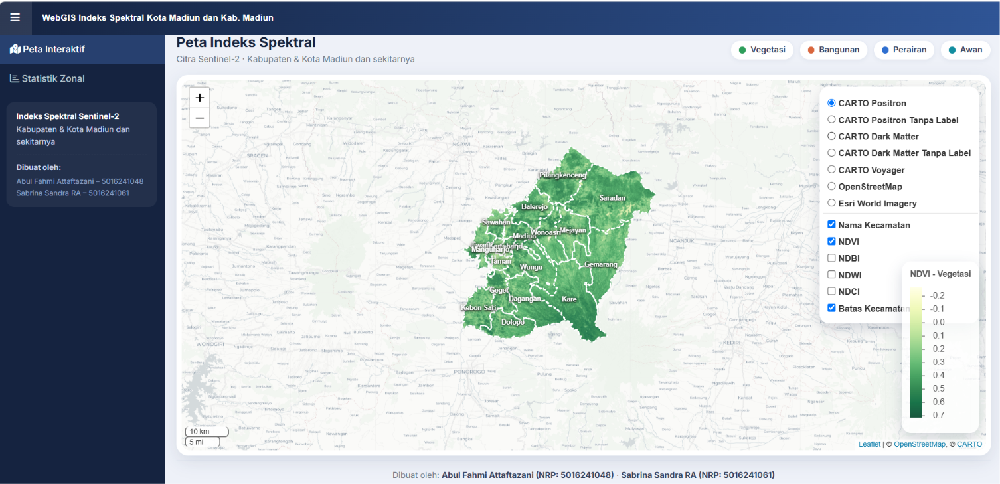
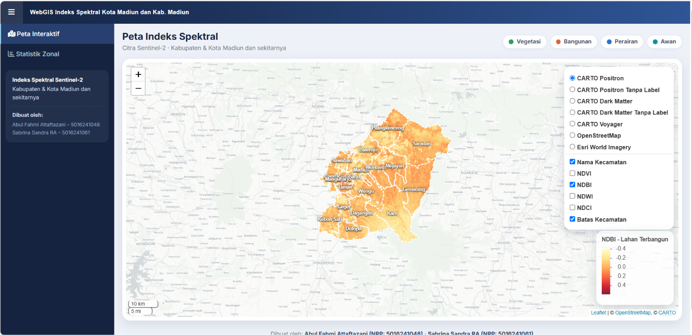
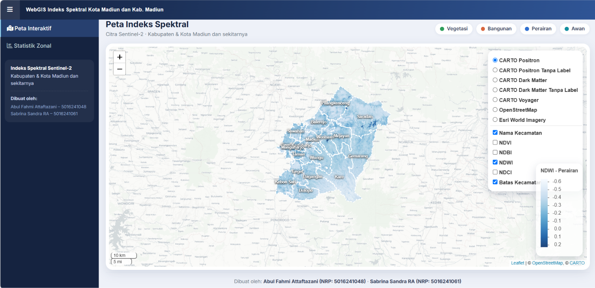
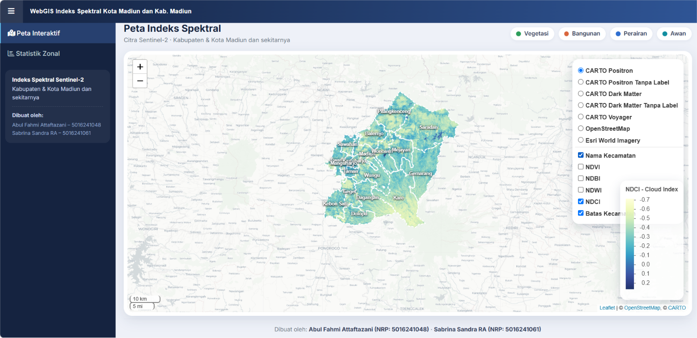
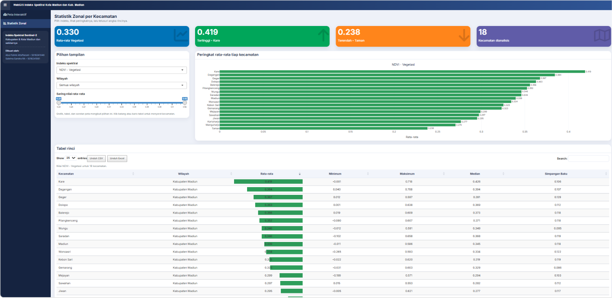

# webgis-indeks-spektral-madiun
WebGIS berbasis R Shiny dan Leaflet untuk visualisasi indeks spektral Sentinel-2 dan analisis statistik zonal di Kabupaten dan Kota Madiun.

# WebGIS Indeks Spektral Kabupaten & Kota Madiun

Dashboard WebGIS berbasis R Shiny dan Leaflet untuk visualisasi
indeks spektral Sentinel-2 dan analisis statistik zonal
pada 18 kecamatan di Kabupaten dan Kota Madiun.

## Daftar Isi
- [Tampilan WebGIS](#tampilan-webgis)
- [Fitur](#fitur)
- [Indeks Spektral](#indeks-spektral)
- [Struktur Proyek](#struktur-proyek)
- [Cara Menjalankan](#cara-menjalankan)
- [Penulis](#penulis)

## Tampilan WebGIS

| Peta NDVI | Peta NDBI |
|---|---|
|  |  |

| Peta NDWI | Peta NDCI |
|---|---|
|  |  |

### Statistik Zonal

## Fitur

- Visualisasi indeks NDVI, NDBI, NDWI, dan NDCI
- Peta interaktif menggunakan Leaflet
- Batas administrasi Kabupaten dan Kota Madiun
- Statistik zonal berdasarkan 18 kecamatan
- Grafik dan tabel interaktif
- Pemilihan indeks dan wilayah kajian

## Indeks Spektral

| Indeks | Keterangan |
|---|---|
| NDVI | Indeks vegetasi |
| NDBI | Indeks lahan terbangun |
| NDWI | Indeks perairan |
| NDCI | Indeks Red-NIR yang digunakan dalam kode |

Catatan: NDCI dalam proyek ini merupakan negatif NDVI
dan belum tervalidasi sebagai metode pendeteksian awan.

## Struktur Proyek

- `app.R` : Aplikasi WebGIS Shiny
- `tubes.R` : Pengolahan citra Sentinel-2
- `Data/` : Data masukan
- `output/` : Hasil pengolahan raster dan statistik
- `docs/` : Dokumentasi dan screenshot WebGIS

## Cara Menjalankan

Instal paket R yang diperlukan dan pastikan seluruh
data masukan tersedia.

Jalankan aplikasi melalui RStudio dengan perintah:

`shiny::runApp()`

## Penulis

Sabrina Sandra RA dan Abul Fahmi Attaftazani

Tugas Besar Pemrograman Spasial — 2026
